# 学伴 v1.3｜从零开始的图文使用教程

给第一次拿到项目、完全不了解它的人。主教程面向 Windows 电脑端完整模式；不需要会编程，也不需要 AI 账号。

> 截图说明：本教程使用学伴 v1.3 发布版的真实电脑端界面，在独立演示副本中操作。课程、老师、任务、通知、进度和考试日期均为虚构示例；课表 OCR 和本地保存实际运行，平台登录与抓取未连接真实账号。截图不是 AI 重绘，也不代表已验证你的学校或账号可以同步。

## 先读这一页：你拿到的是什么？

学伴不是一个所有人共用的网站账号，也不是安装到手机里的原生 App。它在自己的电脑上启动本地服务，再用浏览器显示界面，把课表、待办、平台通知和备考安排放在一起。

“网页界面”不等于“数据在别人服务器上”。正常电脑端完整模式以本机 SQLite 为主；同步时仍会联网访问相应学习平台。可选微信小程序云端功能需要额外配置，本教程不包含该配置。

本教程包只有使用说明、指引图与演示截图，不包含软件。实际使用需另拿到干净的“学伴-发布版-v1.3.zip”。

### 开始前准备

- 一台 Windows 电脑，已经安装 Edge 或 Chrome。
- 第一次启动时可用的网络；后续平台同步也需要联网。
- 自己常用学习平台的账号，以及能够完成扫码或验证的手机。
- 一张清晰的整周课表图片，保留星期列和左侧节次栏；也可以先跳过、以后手动录入。
- 学校确认的开学日期、学期周数和每节课的实际时间。
- 图片识别需要 Windows 中文 OCR 语言功能。缺少时可以先手动录课，不必卡在上传这一步。

### 完成后的目标

你应该能做到：启动工作台 → 看到自己的课表 → 登录需要的平台 → 查看通知 → 把任务放进待办 → 设置考试日期 → 导出一份备份。

---

## 01｜下载后，先完整解压

1. 拿到发布版 ZIP 后，右键选择“全部解压”或使用自己的解压工具。
2. 选择一个准备长期保留的普通文件夹，例如 D 盘的“学伴”。尽量不要放在临时目录。
3. 解压后打开文件夹，找到“启动工作台.bat”。

不要在压缩包里面直接双击程序，也不要只把一个 BAT 或 HTML 文件拖出来。工作台需要同目录的 backend、sync、src 等文件共同工作。

你只需要认识几个入口：

| 文件 | 什么时候用 |
| --- | --- |
| 启动工作台.bat | 第一次和日常启动的推荐入口 |
| 创建桌面快捷方式.bat | 初次准备好后，创建桌面“学伴”图标 |
| 学伴.html | 单文件离线入口，适合手工查看/管理；不是完整模式的替代品 |
| 安装环境.bat | 运行环境准备失败时的排查入口 |
| 自动同步状态.bat | 查看自动同步注册情况 |
| 取消自动同步.bat / 取消每日提醒.bat | 停用对应定时任务 |

> 不要删掉 data 或 sync/state 来“清理缓存”：前者保存工作台数据，后者可能保存平台登录状态。分享给别人应使用干净发布包，不要直接打包自己已经使用过的整个文件夹。

## 02｜启动工作台，认识首次设置向导

1. 双击“启动工作台.bat”。
2. 第一次可能出现下载和安装组件的窗口。保持网络连接，等它完成；耗时取决于网速和电脑，不要连续反复双击。
3. 浏览器通常会自动打开 http://127.0.0.1:8765/。
4. 看到“欢迎使用学伴”后，点击“开始设置 →”。

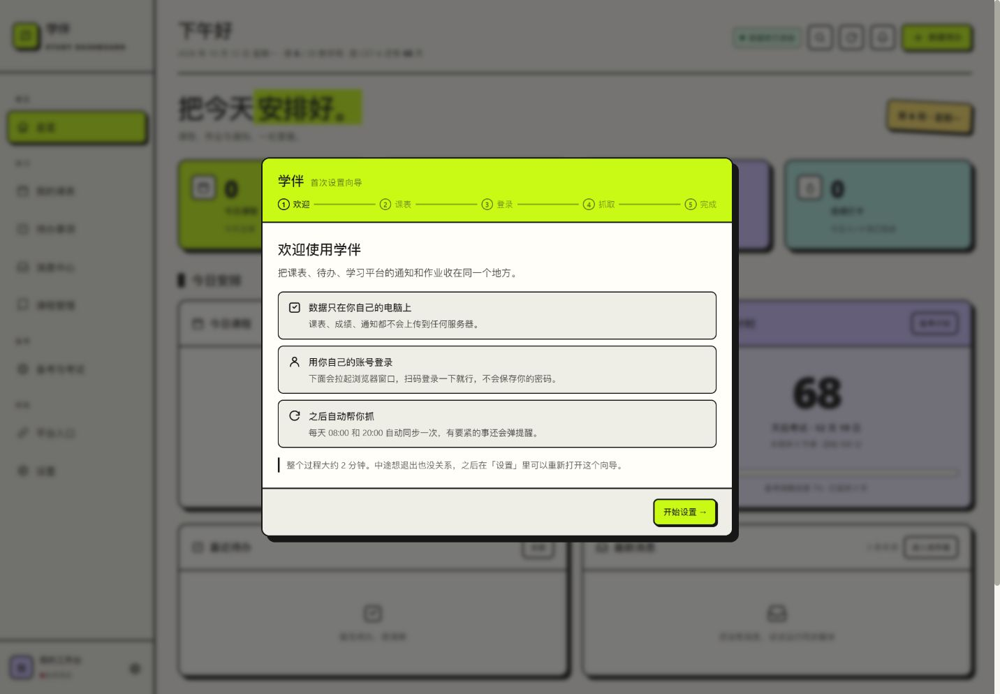

这串地址的意思是“访问这台电脑上的工作台”。它不是公开网站；发给别人后，对方只有在自己的电脑上启动了服务才能使用。

通过 BAT 启动时，服务窗口不要关闭；可以最小化。关闭窗口后，本地服务会停止，浏览器地址也可能打不开。

第一次成功使用后，可以运行“创建桌面快捷方式.bat”，以后从桌面图标进入。只是收藏网址并不会在开机后自动启动服务。

**注意：** 向导中的“之后自动帮你抓”是功能说明，不意味着完成向导就自动开启定时同步或提醒。请以“设置”里的真实状态为准，这两项需要额外开启。

## 03｜填写学期信息，上传自己的课表

进入向导的“课表”步骤后：

1. 填写开学日期。工作台会把这个日期所在周的周一作为第 1 周起点。
2. 填写学期总周数，范围为 1—40。按自己的学校安排填写，不要照抄截图里的 20。
3. 点击“上传课表图片”，选择 PNG、JPG 或 WebP 图片。
4. 等待本机识别完成，再查看下方的“课程草稿”。

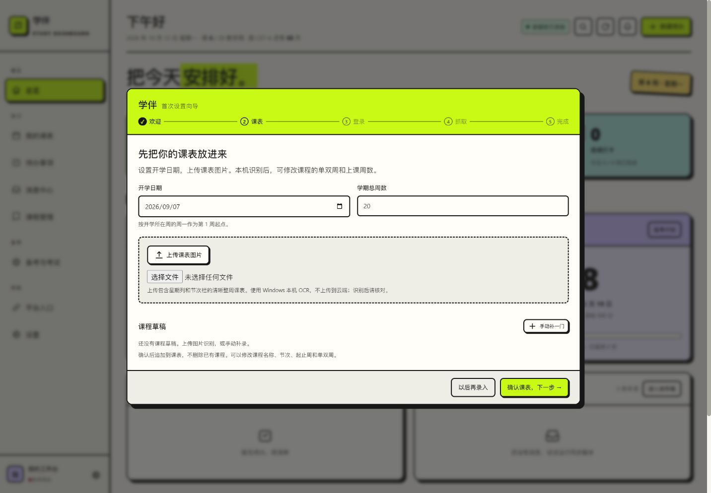

图片最好是教务系统整周课表的清晰截图。不要只截一个课程块，也不要裁掉星期列、节次栏。避免过度压缩、倾斜拍摄或多张课表拼成一张。

单张图片超过 15 MB 会被拒绝；图片太大时先裁掉无关区域。识别在本机进行，不需要 AI 账号，也不会为了识别把图片发给云端大模型。

不想现在录课，可以点击“以后再录入”。之后到“我的课表 → 导入课表图片”重新打开。

教程包附有“示例课表-虚构.png”，只供练习识别。不要把它当作自己的课程安排。

## 04｜识别后必须校对，再确认保存

“识别完成”只是生成了草稿，不等于课程已经全部正确。

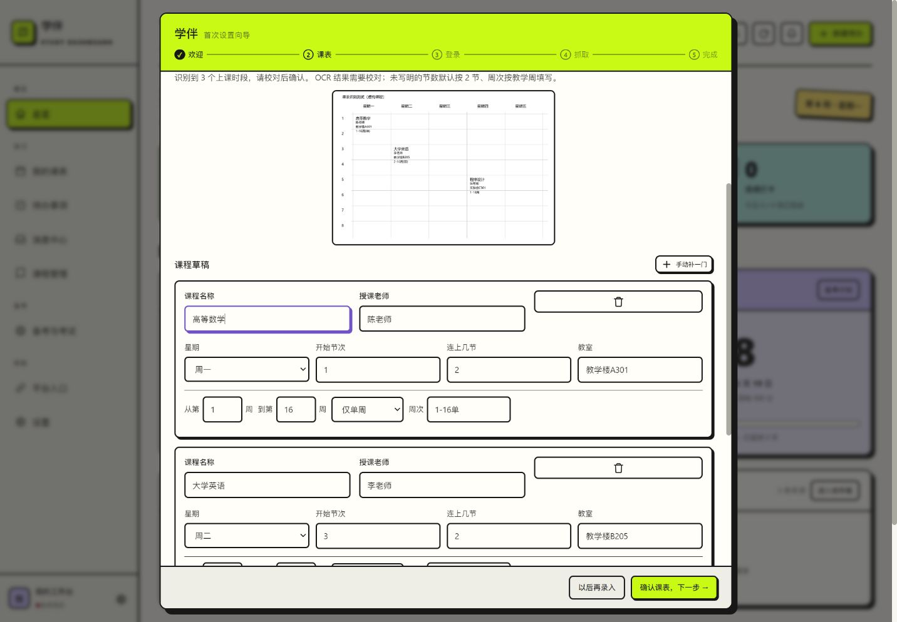

每一条至少检查：

- 课程名称、老师和教室是否正确。
- 星期是否正确。
- “开始节次”和“连上几节”是否正确。
- 起始周、结束周是否正确。
- 每周、仅单周、仅双周是否与原课表一致。

例如，一门课是周二第 3—4 节，应填写“开始节次 3、连上几节 2”，不是把 4 填进“连上几节”。

图片里没写清的节数可能默认按 2 节，周次可能默认按教学周填写。这些是待核对的默认值，不是学校确认的信息。

本次实测中，“大学英语”曾被识别成错误文字；教程截图展示的是手动校正后的结果。其他用户也需要逐项检查，而不是直接点下一步。

漏识别时点击“手动补一门”；无关草稿可以移除。课程较多时，向下滚动弹窗，检查后面的课程。

全部确认后，点击“确认课表，下一步 →”。导入会追加课程，不会清空已有课表；重新上传图片会替换当前尚未保存的识别草稿。

## 05｜连接自己使用的学习平台

向导的“登录”步骤包含：

- 超星学习通。
- 雨课堂。
- 中国大学 MOOC。

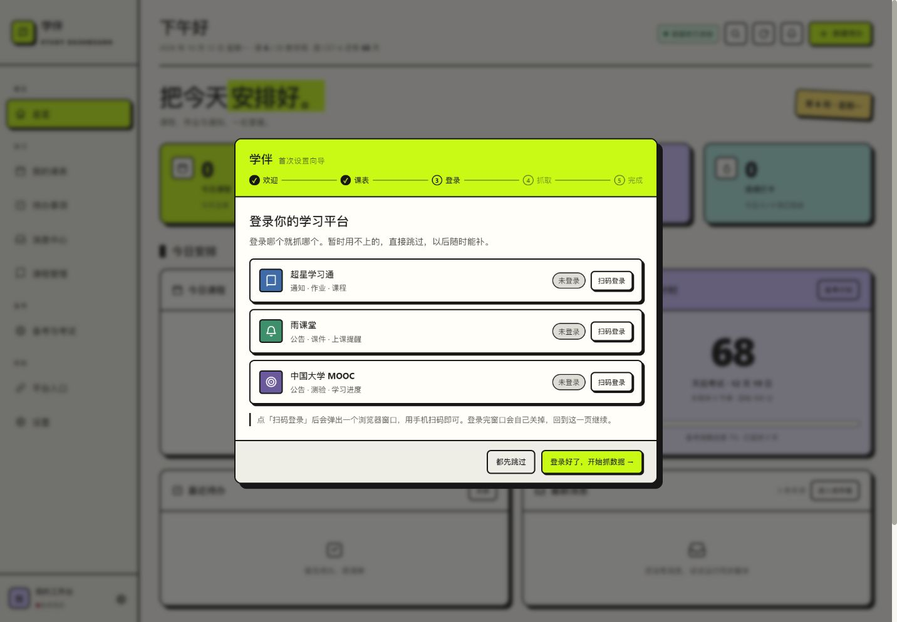

操作顺序：

1. 只选择自己实际使用的平台，点击对应“扫码登录”。
2. 在弹出的官方平台浏览器窗口里，由你自己完成扫码、验证码或其他登录步骤。
3. 登录窗口结束后，回到工作台，等待卡片状态更新。
4. 需要的平台都处理好后，点击“登录好了，开始抓数据 →”。

不使用的平台不必登录。“都先跳过”适合先体验课表与手动待办，但不会因此自动获得未登录平台的数据。

不要把“平台入口 → 打开”理解为“已经授权工作台抓取”。那只是跳转到平台网页；同步所需登录应通过向导完成。

本教程没有登录真实平台，因此图中是“未登录”，没有展示二维码或凭证。具体登录界面和验证方式由平台决定。

> 教务系统不在当前默认自动抓取范围内，课表请用图片导入或手动录入。微信、QQ 群和邮箱也不能直接自动读取，使用手动补录。

## 06｜等待抓取结束，再进入工作台

点击开始抓取后，会显示进度和运行日志。耗时取决于平台数量、网络、课程数量及平台状态，不要把界面的估计时间当作保证。

看到“设置完成”后，点击“进入工作台 →”。

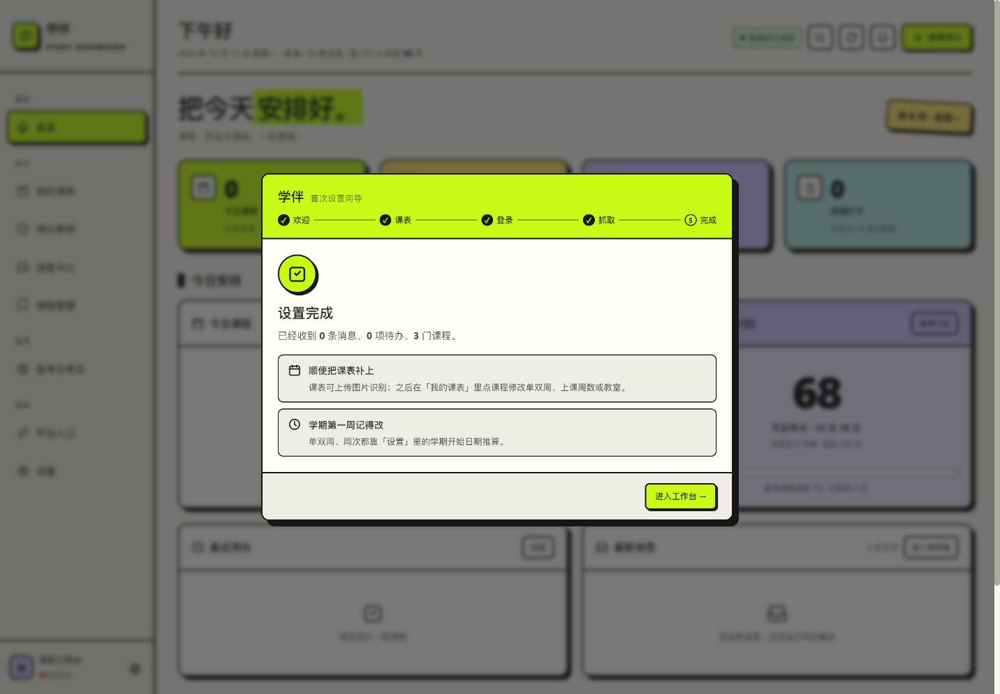

这张截图中，课程来自刚才的课表图片；消息与待办为 0，是因为演示时跳过了真实平台登录，没有进行远程抓取。

真实用户也可能看到 0：平台没有相关信息、未登录、登录失效、接口变化或同步异常都可能导致空结果。“运行结束”并不等于“一定抓到了全部数据”。

进入后先核对：课程是否是自己的，平台状态是否正常，是否有新消息；不要把空列表理解为“肯定没有作业”。

## 07｜认识首页和左侧导航

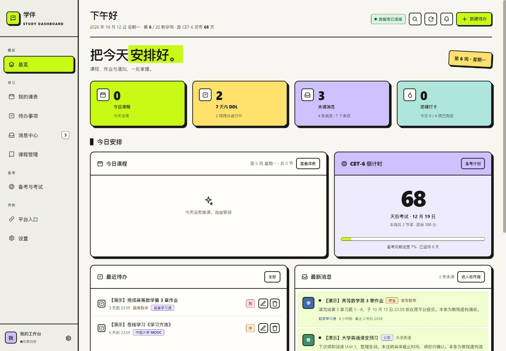

首页建议先看三个地方：

1. **今日课程**：今天有没有课；没有课不代表整周没有课。
2. **7 天内 DDL**：未来一周内有截止时间的任务。DDL 就是截止时间。
3. **未读消息**：尚未查看的通知；读过通知不等于任务已经完成。

左侧导航是工作台的主要入口：

| 页面 | 主要用途 |
| --- | --- |
| 总览 | 看今天、临近截止和最新消息 |
| 我的课表 | 按周查看课程、导入图片、调整上课安排 |
| 待办事项 | 查看和处理任务 |
| 消息中心 | 筛选、搜索和整理通知 |
| 课程管理 | 查看课程、编辑课程与上课时段 |
| 备考与考试 | 四六级打卡、期末考试日期和倒计时 |
| 平台入口 | 访问平台、查看状态、手动补录通知 |
| 设置 | 学期作息、提醒、同步、备份 |

首页右上角“数据库已连接”表示本机服务可用；若显示“离线缓存”，请检查是否从“启动工作台.bat”进入，不要误以为所有数据已经写入数据库。

本页以后的消息和待办由教程演示数据提供，标题带“【演示】”。实际新用户不会自动得到这些示例通知。

## 08｜修改课表：单双周、起止周和上课时间

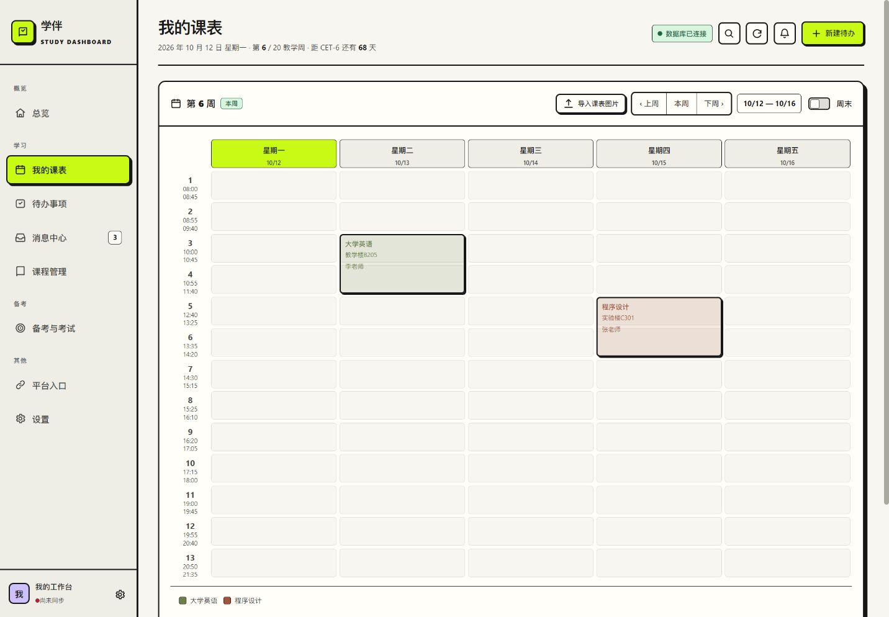

“我的课表”顶部可以切换“上周 / 本周 / 下周”。切换周次时，只有单周或双周上课的课程会随之显示或隐藏。

要修改一门课：

1. 点击课表上的课程块，打开详情。
2. 点击“编辑课程”。
3. 在“上课时间安排”里调整星期、开始节次、连上几节和教室。
4. 修改起始周、结束周和单双周。
5. 点击“保存”，再回课表核对。

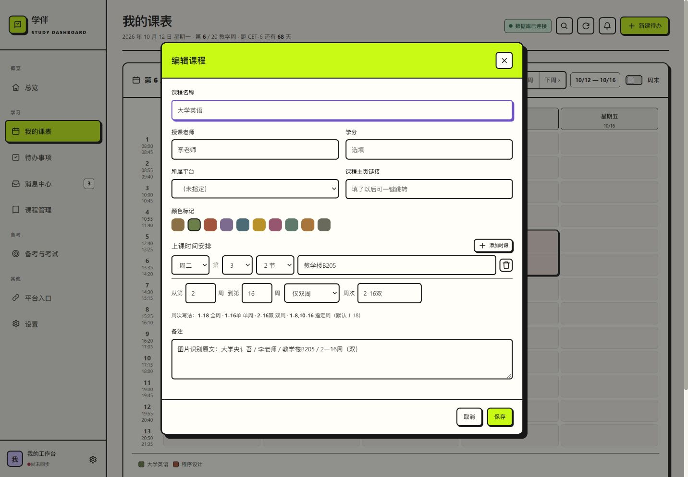

图中“大学英语”示例是从第 2 周到第 16 周，仅双周上课。因此它在第 6 周会出现，在第 5 周不会出现。

单周指教学周的 1、3、5……；双周指 2、4、6……，不是公历每月日期的单数和双数。

不连续的安排可以选择“自定义周次”，例如 1-8,10-16，表示第 1—8 周以及第 10—16 周。输入不要超出学期总周数。

同一门课一周上多次，可以“添加时段”。临时调课应保留原来的其他周次，并另加特殊时段，不要简单地把整学期的星期全部改掉。

课表空白格也可以快速新建课程。如果课程块被单双周规则隐藏，可以到“课程管理”找到并编辑。

**作息也要核对：** 到“设置 → 学期与作息”选择合适模板；学校不同，可以展开“高级：逐节自定义上课时间”。不要照搬其他学校的上下课时间。

## 09｜消息中心：看通知、搜索，再转成待办

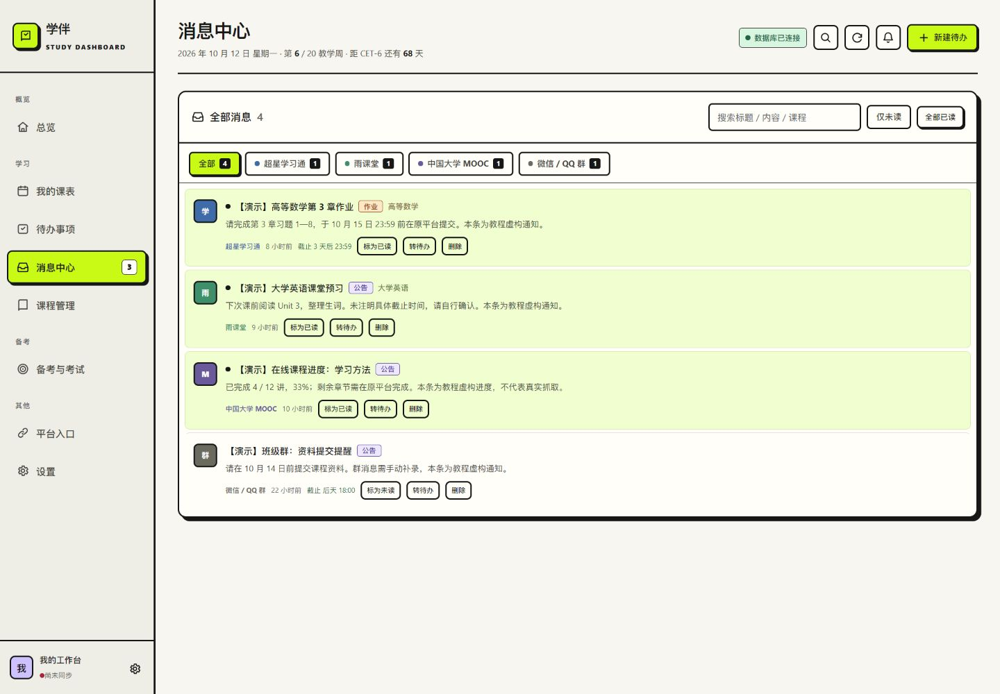

常用操作：

1. 用来源按钮筛选学习通、雨课堂、MOOC 等消息。
2. 在搜索框输入课程名或关键词。
3. 用“仅未读”查看尚未处理的信息。
4. 对需要行动的通知，点击“转待办”。
5. 在待办页面确认任务内容、截止时间和优先级。

“标为已读”只改变消息阅读状态，不会代表已提交作业。点击“全部已读”也只是批量改变阅读状态。

消息有“去处理 →”时，可跳回原平台处理；没有原文链接时，请自行到平台查找。提交作业、完成测验和实际网课学习仍在原平台完成。

**特别重要：** 当前版本中，手动点击“转待办”，如果通知没有截止时间，会预填默认的明天 23:59。这不是老师给出的截止日期。请立即编辑并核对；还不确定时，可以清空截止时间，在备注里写“待确认”。

同一条消息不要反复点“转待办”，否则可能生成重复的手动待办。同步自身的去重，不等于这个按钮永远不会重复添加。

## 10｜待办：新建、编辑、完成和在线学习

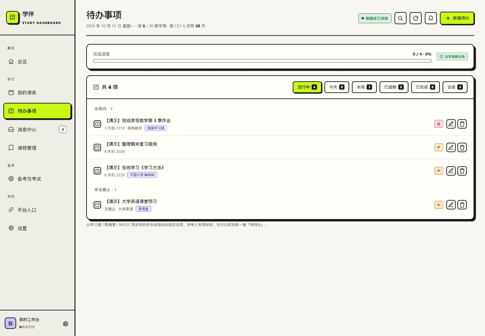

待办页面可以按“进行中、今天、本周、已逾期、已完成、全部”筛选。

### 手动添加一项任务

1. 点击右上角“新建待办”，或按 N。
2. 填写具体任务内容，例如“整理期末复习提纲”。
3. 核对截止时间，选择高、中或低优先级。
4. 按需关联课程，填写备注。
5. 点击“添加”。

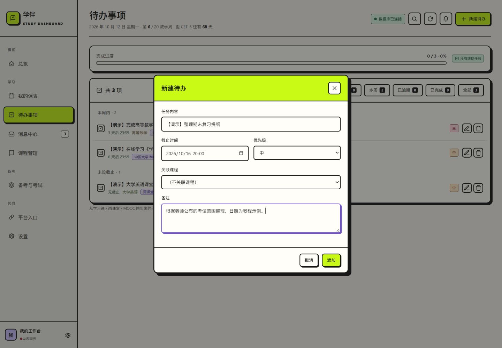

新建表单也会预填默认截止时间。没有确定的时间时，不要直接沿用默认值。

### 修改一项待办

点任务右侧“编辑”，修改内容或清空不确定的截止时间，再保存。

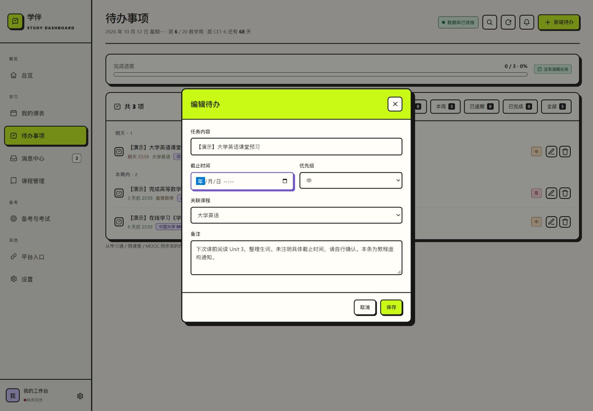

### 标记完成

真正做完后，点击任务左侧方框。想找已完成任务，切换到“已完成”或“全部”。

在工作台里勾选完成，只是个人管理状态，不会代你在教学平台提交作业，也不是平台已经判定完成的证明。

### MOOC 怎么看？

在线学习任务放在“待办事项”，进度相关信息出现在“消息中心”，不必在固定时段的线下课表里寻找。

它用于提醒继续学习，不提供自动刷课。任务信息以成功同步时获得的结果为准，不是实时监控；完成后可再次同步查看变化。

删除任务属于移除记录，不是完成任务；同步生成的任务删除后，工作台会记住删除状态，可能不会在下一次同步重新出现。拿不准时先编辑或完成，不要随意删除。

## 11｜群消息和邮件：手动补录，不会自动读取聊天记录

1. 点击左侧“平台入口”。
2. 向下找到“手动补录消息”。
3. 选择来源平台，例如“微信 / QQ 群”。
4. 填写标题和原文内容，按需关联课程、选择类型。
5. 有明确截止时间时填写；不清楚就暂时留空。
6. 点击“录入消息”。

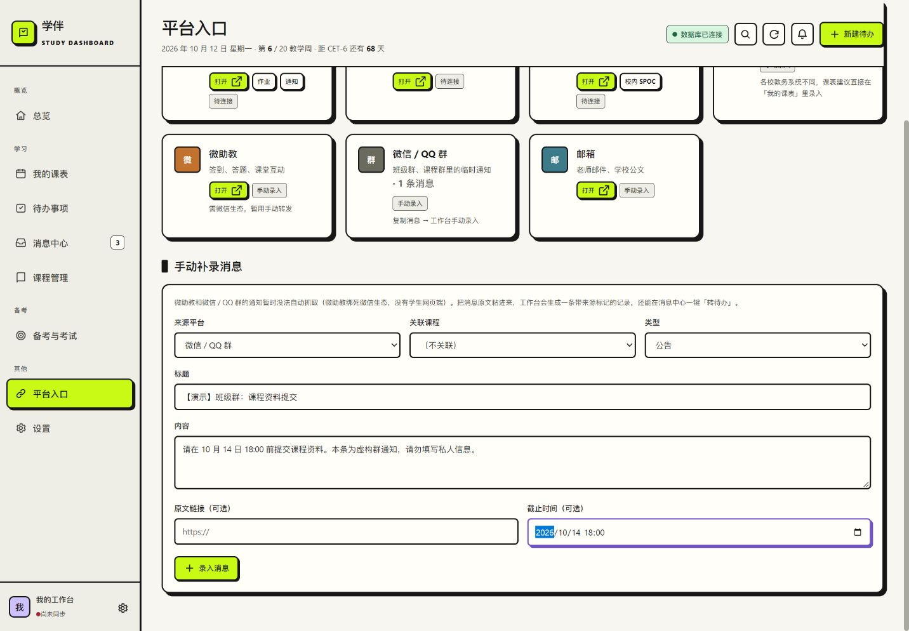

录入后，这条信息出现在消息中心。如果需要执行，再到消息中心点“转待办”，并按上一节核对截止时间。

这是手动复制通知，不是让工作台读取整个群聊。不要粘贴与学习安排无关的隐私信息。

## 12｜设置期末考试和四六级备考

### 添加期末考试

1. 打开“备考与考试”。
2. 点击顶部“添加期末考试”。
3. 填写考试名称和学校正式公布的日期。
4. 关联课程、考试地点和备注是选填。
5. 点击“保存考试日期”。

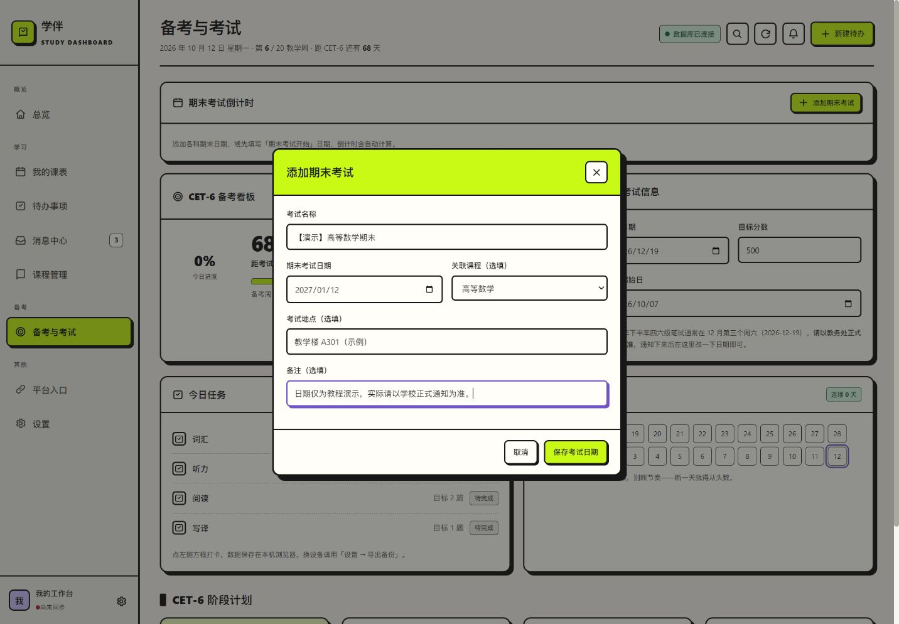

可以分别添加多门期末考试。还不知道各科日期时，也可以先添加一项“期末考试开始”，之后再补充各科安排。

保存后会显示最近一场考试的倒计时；考试当天显示“今天考试”，过去日期显示“已结束”。

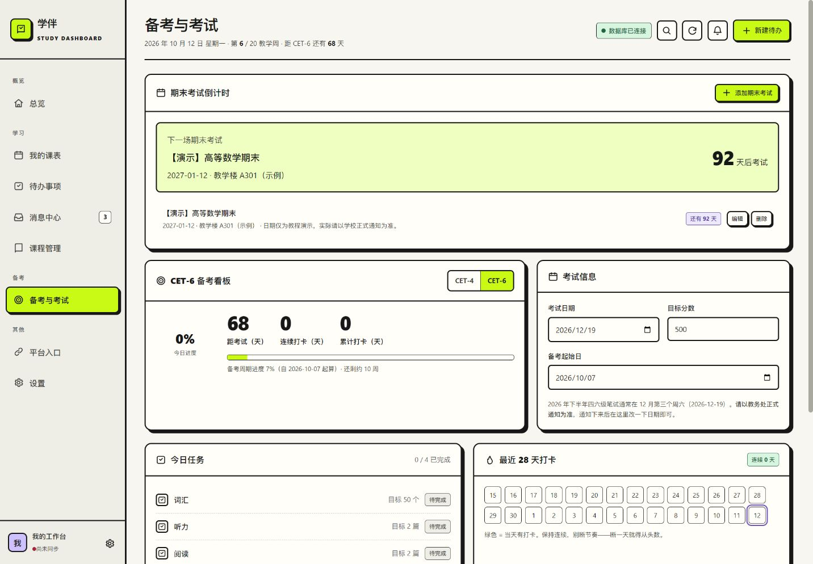

截图中的日期、地点、倒计时仅为演示，不是考试官方安排。

期末考试倒计时与四六级日期独立。不要为了设置期末考试，修改下面的四六级考试日期。

### 四六级与打卡

选择 CET-4 或 CET-6，按实际通知核对考试日期，设置目标分数和备考起始日。完成词汇、听力等任务后，点左侧方框打卡。

界面默认日期不能代替教务处或考试机构正式通知。打卡记录只是个人记录，不会自动证明你完成了对应练习，也不保证分数提升。

## 13｜同步和提醒是两件不同的事

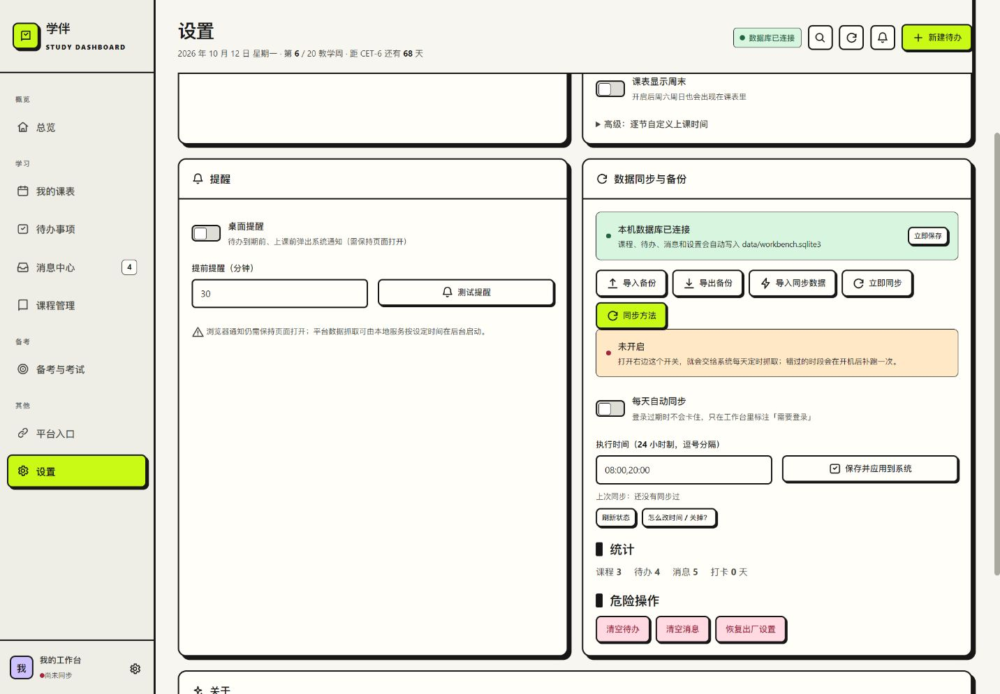

### A. 手动同步：让数据更新

日常优先使用“设置 → 数据同步与备份 → 立即同步”，或“平台入口 → 立即同步”。

顶部圆形箭头“数据同步”主要用于打开同步方法说明，不要把点开说明当成已经执行了抓取。

等同步结束后，回消息中心和待办查看新增内容，必要时刷新页面。平台登录过期时，应先重新登录，而不是一直重复抓取。

**补登录的平台入口：** “设置 → 同步方法 → 重看设置向导”，完成需要的平台登录后再同步。已经保存的课表不必重新上传，可在课表步骤选择“以后再录入”。

### B. 自动同步：按时间抓取

完整模式下，可在“设置 → 每天自动同步”配置 24 小时制时间，如 08:00,20:00。

先填写时间，再开启开关；开启后修改时间，点击“保存并应用到系统”。如果开关没开启，仅保存时间不会启用定时任务。

操作后点击“刷新状态”，只有明确显示已开启，才算成功。若显示“开机自启（备用方案）”，表示每次登录电脑后运行一次，不等于一天按多个时段执行。

电脑关机时不会继续抓取。任务错过后是否补跑，需要以电脑恢复运行及任务实际状态为准。

**当前 v1.3 发布包的已知限制：** 已核对的自动同步/每日提醒注册脚本，以及“一键同步数据.bat”“重新登录.bat”等部分快捷脚本，仍优先查找旧的 .venv 或原开发环境路径，没有兼容首次安装的 runtime 路径。因此，纯新电脑可能提示环境未就绪或找不到 pythonw。此时先使用页面里的“立即同步”和“重看设置向导”；定时同步与独立每日提醒需修复快捷脚本后再使用，不能根据开关点击或旧说明认定已经成功。不要为此反复重装，也不要关闭系统安全保护。

### C. 页面桌面提醒：提醒你有事要做

到“设置 → 提醒”，按需开启“桌面提醒”，由你自行处理浏览器通知授权，设置提前提醒分钟数，再点击“测试提醒”。

这种提醒需要工作台页面保持打开。看不到系统通知时，检查浏览器通知授权和系统免打扰设置，不要把网页没有弹通知理解为任务已经完成。

### D. 独立每日提醒：可选功能，不是默认开启

项目提供“注册每日提醒.bat”，设计上由独立系统任务每天汇总提醒，不依赖网页一直打开；它与自动同步任务是分开的。

但当前发布包存在上面所述运行环境路径问题，本教程没有注册或验证此功能在纯新电脑上的运行。需先修复并验证注册成功，再使用“立刻提醒我.bat”测试。不想用了可运行“取消每日提醒.bat”。

本教程不要求新用户一开始就启用定时功能，先完成手动同步和基本操作即可。

## 14｜备份、换电脑和更新版本

建议第一次设置完成后，就导出一份备份。

1. 打开“设置 → 数据同步与备份”。
2. 点击“导出备份”。
3. 保存生成的 JSON 文件到自己找得到的位置；可以按学期或日期整理。
4. 以后重要修改后，再导出新备份。

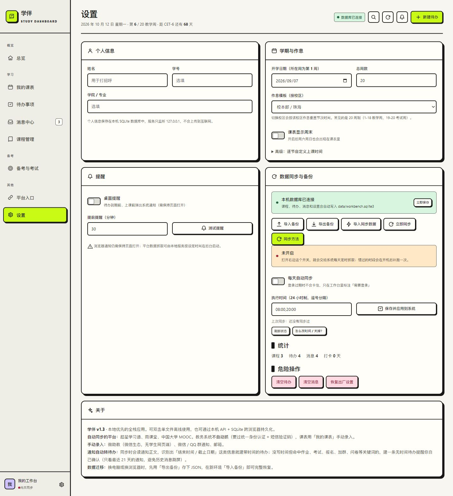

换电脑时：先安装并启动新电脑上的工作台，再“导入备份”，选择自己的 JSON 文件。

**导入备份会覆盖当前工作台数据。** 如果新电脑已经录入了内容，先导出一份备份再导入，确认无误后再继续。

课表、待办、消息、设置和考试安排可随备份迁移；平台登录状态不是这份 JSON 备份的替代品，新电脑通常还需要自己登录平台。

更新版本时，先导出备份，保留旧文件夹，不要用新版本直接覆盖唯一的一份数据。若注册过定时任务，移动、删除或更换目录前，要先取消旧任务，再在新目录重新配置，避免任务继续指向旧位置。

停用工作台时，先备份，再取消已注册的自动同步/每日提醒，关闭服务。不要把“删除文件夹”理解为必然会连系统计划任务也一起清理。

## 15｜遇到问题，按这个顺序排查

| 现象 | 先做什么 | 不要做什么 |
| --- | --- | --- |
| 开机后点收藏的网址打不开 | 先双击“启动工作台.bat”或桌面快捷方式；等服务启动 | 只反复刷新网页，不启动服务 |
| 启动窗口正在下载组件 | 保持联网，等准备完成；失败时记录错误 | 同时开多个安装/启动窗口 |
| 提示端口 8765 被占用 | 先检查是否已有一个工作台实例；保留启动报错供排查 | 随意结束不认识的进程 |
| 显示“离线缓存” | 确认本机服务运行，从完整模式进入 | 认为已经保存到 SQLite |
| 首次向导没出现 | 到设置中的同步方法重看向导；确认不是单文件模式 | 恢复出厂或删除数据库来强行触发 |
| 课表上传失败或没有草稿 | 检查格式、大小、清晰度及中文 OCR；也可手动补录 | 认为上传成功就一定识别成功 |
| 课表课程缺失 | 检查当前教学周、开学日期、单双周、起止周和周末显示 | 直接重复导入整张课表 |
| 平台无消息 | 检查是否登录、是否有实际通知、是否同步成功和筛选条件 | 把空消息列表当成平台没有任务 |
| 登录过期 | 从重看设置向导重新登录相应平台 | 修改或外传登录状态文件 |
| 通知转待办后日期奇怪 | 编辑并核对；不确定就清空截止时间 | 把默认明天 23:59 当成正式截止 |
| 新电脑 BAT 提示找不到 Python/pythonw | 先用页面立即同步/向导；定时功能按已知限制处理 | 无限重装环境或绕过安全提示 |
| 提醒没出现 | 区分页面提醒和独立任务；检查是否开启、页面是否打开和权限 | 认为“同步已开”就等于“提醒已开” |

需要求助时，优先提供：版本号、点击了哪个入口、可见报错文字，以及已遮去私人内容的截图。

“抓取诊断”会生成较详细的请求和响应记录，可能包含私人通知或凭证相关信息。不建议把完整 debug 文件夹直接公开发布；如需要诊断，先确认范围并脱敏。

## 16｜第一次使用完成检查表

- [ ] 发布包已经完整解压，文件夹会长期保留。
- [ ] 本机服务能启动，页面显示“数据库已连接”。
- [ ] 开学日期、总周数和节次时间按自己的学校核对。
- [ ] 课表名称、教室、节次、起止周和单双周已经校对。
- [ ] 需要的平台已登录，或者明确选择暂时跳过。
- [ ] 已经检查第一次同步结果，而不是只看到“结束”。
- [ ] 能新建一项待办，能编辑并核对截止时间。
- [ ] 能补录一条群消息，再找到它。
- [ ] 已按正式通知填写自己的考试日期。
- [ ] 知道自动同步和提醒不是同一件事。
- [ ] 已经导出第一份备份。
- [ ] 不把登录状态、密钥和自己的数据库随项目公开分享。

## 建议的日常使用习惯

早上：先启动，看看总览与今日课程。
收到新通知：查看原文；需要行动的内容进入待办。
完成任务：先在原平台提交/完成，再在工作台记录状态。
每周：核对下周课程、临近截止和考试日期。
重要修改后：导出一份备份。

学伴负责帮助你整理学习安排，不代替原平台的提交、学习、考试和正式通知。

---

教程版本：v1.3；整理日期：2026-10-12。
截图数量：18 张。独立指引图：12 张。
所有相对图片路径都在教程包内部；解压后请保留整个教程文件夹。

